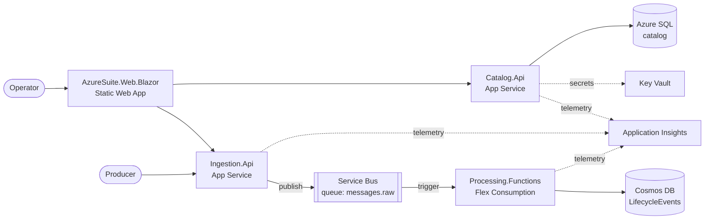

# AzureSuite — Financial Messaging Hub

A study project for learning Azure hands-on: infrastructure as code (Bicep), CI/CD (GitHub
Actions), and the main Azure building blocks (App Service, Functions, Service Bus, Cosmos DB,
Azure SQL, Key Vault, Static Web Apps, Application Insights). It's all built around one
realistic domain instead of disconnected samples.

## What it does

The **financial messaging hub** is a simplified version of the message switch systems run by
SWIFT- or Euroclear-style networks. Producers submit financial messages (ISO 20022 types such
as `pacs.008`). The hub checks each message against a catalog of registered message types,
works out which subscribers should receive it, delivers it, and keeps a full audit trail of
each message's lifecycle.

**The problem it solves (for the study):** every Azure service in the solution is there
because the domain needs it. Messages need a durable queue (Service Bus), event-driven
processing (Functions), an audit log (Cosmos DB), reference data (SQL), and someone has to see
what happened (App Insights).

## Architecture



**Working today:** you register message types, clients and routes in Catalog, submit a message
through Ingestion, and Processing records it as a `Received` lifecycle event in Cosmos DB.
Malformed messages are dead-lettered, and a nightly housekeeping job moves them into the log.

**Not built yet:** Processing doesn't call Catalog to validate or route yet. Delivery, Archive
and Monitoring don't exist. There's no authentication. See [Roadmap](#roadmap).

## Repository map

| Path | What's there | Guide |
|---|---|---|
| [services/Catalog/](services/Catalog/) | Registry of message types, clients and routes (REST API + SQL) | [docs/services/catalog.md](docs/services/catalog.md) |
| [services/Ingestion/](services/Ingestion/) | Public entry point: accepts messages and publishes them to Service Bus | [docs/services/ingestion.md](docs/services/ingestion.md) |
| [services/Processing/](services/Processing/) | Azure Functions that consume the queue and write the lifecycle log | [docs/services/processing.md](docs/services/processing.md) |
| [services/Shared/](services/Shared/) | `AzureSuite.Observability`: logging, App Insights and health checks for every service | [docs/services/observability.md](docs/services/observability.md) |
| [frontends/AzureSuite.Web.Blazor/](frontends/AzureSuite.Web.Blazor/) | The operator UI (Blazor WebAssembly) | [docs/services/web-blazor.md](docs/services/web-blazor.md) |
| [tests/](tests/) | One `X.Y.Tests` project per source project, mirroring its folders | — |
| [infra/](infra/) | Bicep: `main.bicep` plus one module folder per service | [docs/infrastructure.md](docs/infrastructure.md) |
| [.github/workflows/](.github/workflows/) | `build.yml` (build, test, deploy apps) and `deploy-infra.yml` | [docs/infrastructure.md](docs/infrastructure.md) |
| [docs/superpowers/](docs/superpowers/) | Design specs and implementation plans, one pair per feature | — |
| [docs/progress-log.md](docs/progress-log.md) | Decision journal: what was built, what broke, and why | — |

## Tech stack

.NET 10 · C# · ASP.NET Core minimal APIs · MediatR (lightweight CQRS) · EF Core (SQL Server) ·
Azure Functions (isolated worker) · Blazor WebAssembly · xUnit + FluentAssertions + bUnit ·
Bicep · GitHub Actions with OIDC (no stored Azure secrets).

## Running locally

Prerequisites: .NET 10 SDK, Azure CLI (`az login`), SQL Server LocalDB. For Processing you also
need Azure Functions Core Tools and Azurite.

```powershell
dotnet build AzureSuite.slnx
dotnet test AzureSuite.slnx
```

Each service's guide covers its own local setup: connection strings live in user-secrets, and
Functions use `local.settings.json`. VS Code launch configurations and tasks for the APIs, the
Blazor app and the Functions host are in [.vscode/](.vscode/).

## How work flows

- **Branches:** `feature/*` (or `fix/*`, `docs/*`) → PR into `develop` → PR `develop` →
  `master`. Both `develop` and `master` are protected, and merged branches are deleted
  automatically.
- **Deploys:** merging to `master` deploys. `build.yml` deploys the apps and `deploy-infra.yml`
  applies Bicep when `infra/**` changes. Everything lands in resource group
  `rg-messaginghub-dev` (West Europe).
- **Conventions:** warning-free builds, nullable enabled, block-scoped namespaces, no top-level
  statements, minimal APIs, and XML doc comments on classes. Every source project has a 1:1
  test project.

## Roadmap

Tasks, bugs and ideas are tracked as [GitHub Issues](https://github.com/kincoder/AzureSuite/issues)
on the project board. Main milestones, in build order:

1. ✅ Catalog — message types, clients, routes, schema validation, route lookup
2. ✅ Ingestion — accept and publish messages
3. 🟡 Processing — receive and log is done; validate, route and fan-out are next
4. ⬜ Delivery — per-subscriber delivery with retries
5. ⬜ Archive — immutable raw payloads in Blob Storage
6. ⬜ Monitoring — lifecycle timeline and ops dashboard
7. ⬜ Angular frontend with Module Federation, as a counterpart to the Blazor app
8. ⬜ Auth (Entra ID) and production hardening
